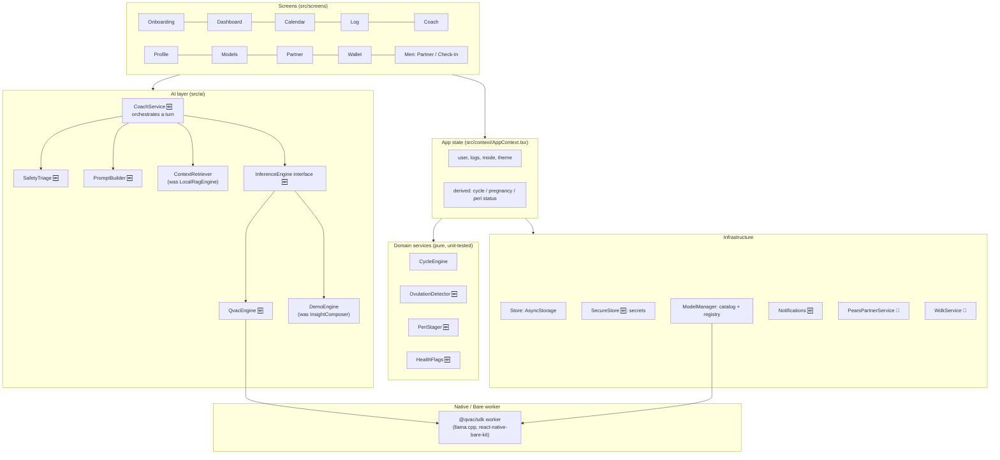
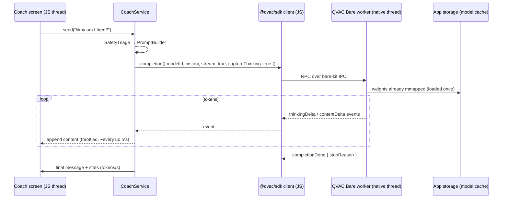

# 1. System Architecture

## 1.1 Principles

1. **Local-first.** All personal data and all AI inference stay on the phone. There is no LunaPredict server.
2. **One source of truth per fact.** Logs live in the store. Predictions are always *computed* from
   logs plus the profile, never stored.
3. **Explicit beats inferred.** If the user says "my period started today", that overrides any heuristic.
4. **Honest UI.** Anything simulated is labelled as a demo. The app never says "on-device AI" while
   it's running templates.
5. **Fail safe for health.** Emergencies are detected before the model runs, and the model can never
   suppress a safety message.

## 1.2 Layers



**Dependency rule:** screens depend on context and services; services never import screens; the
domain layer imports nothing from React. That keeps the tracking maths testable with plain Jest.

## 1.3 Runtime topology (with real QVAC)



- llama.cpp runs in the **Bare worker**, not on the JS thread, so the UI stays responsive while
  tokens stream.
- Only one completion runs at a time. Stop calls `cancel({ requestId })`.

## 1.4 Build modes

| Mode | How it's launched | Coach engine | Use for |
|---|---|---|---|
| **Expo Go** | `npx expo start` → scan QR | `DemoEngine` (labelled "Demo mode") | UI work, fast iteration |
| **Dev build (APK)** | `eas build --profile development` once, then `npx expo start --dev-client` | `QvacEngine` | Real AI on your phone, still with live reload |
| **Preview APK** | `eas build --profile preview` | `QvacEngine` | Sharing with testers, release-like checks |

Engine selection at runtime:

```ts
// src/ai/engine.ts (design)
const isExpoGo = Constants.executionEnvironment === 'storeClient';
export const engine: InferenceEngine = isExpoGo || !qvacNativeAvailable()
  ? new DemoEngine()
  : new QvacEngine();
```

QVAC needs native code (`react-native-bare-kit`, the `@qvac/sdk/expo-plugin`, Android `minSdkVersion` 29),
so it **cannot** run in Expo Go. It also doesn't run on emulators (a llama.cpp limitation), so test
on a physical phone. Details: [04 §4.9](04-local-ai-qvac.md#49-expo--native-setup).

## 1.5 Target folder layout

```
src/
  types/            domain types (add LogDay, OvulationEvidence, PeriStage, HealthFlag)
  storage/          Store.ts (schema v2), SecureStore.ts 🆕
  domain/ 🆕        pure maths, no React: cycle/, ovulation/, pregnancy/, peri/, flags/
  services/         ModelManager, Notifications 🆕, PearsPartnerService, WdkService
  ai/
    engine/         InferenceEngine.ts, QvacEngine.ts 🆕, DemoEngine.ts
    coach/          CoachService.ts 🆕, PromptBuilder.ts 🆕, SafetyTriage.ts 🆕, ContextRetriever.ts
  context/          AppContext.tsx (+ reset of all singletons)
  navigation/       AppNavigator.tsx (+ LogDay route param)
  screens/          one file per route (see routes/*.md)
  ui/               design-system primitives
__tests__/ 🆕       mirrors src/
.maestro/ 🆕        on-device e2e flows
qvac.config.json 🆕
```

`CycleEngine.ts` moves into `src/domain/cycle/` and is split by concern. The public function
`computeCycleStatus(user, logs, today)` keeps its signature so screens don't change.

## 1.6 State management

- `AppContext` holds `user`, `logs`, `partnerLink`, and derives `cycle`, `pregnancy` and `peri`
  with `useMemo`.
- Services are module singletons (`ModelManager`, `WdkService`, `PearsPartnerService`) with
  `subscribe()`. **Every singleton gets a `reset()` method**, and `resetApp()` calls all of them.
  Today it doesn't ⚠️.
- Writes go service → Store → emit → React state. Screens never write to AsyncStorage directly
  (the Logger reads `Store.getLogForDay` directly today; move it behind context).
- `updateUser` currently writes to storage inside a `setState` updater. Move the write out, because
  React may call updaters twice.

## 1.7 Cross-cutting rules

| Rule | Why |
|---|---|
| Calendar dates are **local `YYYY-MM-DD` strings** (`LogDay`). Instants are ISO strings with `Z`, and the two are never mixed | Fixes the UTC date bug ([02](02-data-and-storage.md#the-date-bug)) |
| All "today" logic takes `today` as a parameter | Deterministic tests |
| No health number shown without its confidence | Predictions are estimates |
| Every screen has loading, empty and error states | End-to-end robustness |
| Logs never leave the device, except the partner snapshot (filtered by sharing preferences) and user-initiated export | Privacy promise in onboarding |
