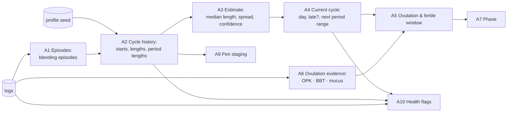

# 3. Tracking Algorithms

This doc defines the maths behind every number the app shows. All functions are pure:
`(user, logs, today) → status`. They live in `src/domain/` and are covered by the test vectors at
the bottom.

> **Scope and safety.** LunaPredict gives *estimates for awareness*. It is **not a contraceptive**
> and doesn't diagnose. The UI and the coach must say so wherever fertility is shown.

## 3.0 Research basis

| Fact used | Value | Source |
|---|---|---|
| Real-world cycle length | Mean 29.3 days. Only ~13% of cycles are exactly 28 days; 65% of women fall in 25–30 | Bull et al. 2019, *npj Digital Medicine*, 612,613 cycles ([PMC6710244](https://www.ncbi.nlm.nih.gov/pmc/articles/PMC6710244/)) |
| Follicular / luteal length | Follicular mean 16.9 days (95% CI 10–30); luteal mean 12.4 days (95% CI 7–17) | Bull et al. 2019 |
| Most variation is follicular | So ovulation is best placed by counting **back** from the next period | Bull et al. 2019 |
| Fertile window | 6 days, ending on ovulation day. Conception probability ~0.10 at day −5, ~0.33 on ovulation day | Wilcox, Weinberg & Baird 1995, *NEJM* 333:1517 ([PDF](https://www.talmudology.com/s/TIMING-OF-SEXUAL-INTERCOURSE-IN-RELATION-TO-OVULATION-NEJM-1995.pdf)) |
| Normal cycle (adult) | Frequency 24–38 days, regularity (shortest-to-longest spread) ≤ 7–9 days, duration ≤ 8 days | FIGO AUB System 1 (Munro, Critchley & Fraser), summarised in [Merck Manual](https://www.merckmanuals.com/professional/multimedia/table/normal-menstrual-parameters) |
| BBT thermal shift | "3-over-6": three temperatures above the highest of the previous six; third ≥ coverline + 0.2 °C. Confirms ovulation after the fact | Marshall 1968; [TCOYF Celsius guidelines](https://www.tcoyf.com/celsius-guidelines/) |
| LH surge → ovulation | Ovulation usually follows the first positive ovulation test (OPK) by about 1 to 1.5 days | Standard clinical guidance; confirm wording before shipping user-facing copy |
| Pregnancy dating | Due date = LMP + 280 days (Naegele). Trimesters: T1 to 13w6d, T2 14w0d–27w6d, T3 28w0d+ | ACOG |
| Fetal movement | Contact the provider if fewer than 10 movements in 2 hours (from ~28 weeks) | ACOG guidance as cited by [Northfield Hospital](https://www.northfieldhospital.org/fetal-movement-kick-counts); verify against ACOG before shipping copy |
| Menopause staging | Early transition: persistent ≥ 7-day difference between consecutive cycles. Late transition: ≥ 60 days without bleeding. Menopause: 12 months without bleeding | STRAW+10, Harlow et al. 2012 ([PMC3340903](https://pmc.ncbi.nlm.nih.gov/articles/PMC3340903)) |

## 3.1 Pipeline



## A1. Period start detection

**Today** ([CycleEngine.ts:35](../../src/services/CycleEngine.ts#L35)): any day with `flow !== 'none'`,
**including spotting**, starts a new period if it comes more than 14 days after the previous flow day.

⚠️ **Verified failure:** periods on Jul 1, Jul 29, Aug 26 and Sep 23 (28-day cycles). Today is
Oct 15 (day 23, period due Oct 21). Logging **spotting on Oct 9** (mid-cycle, a common ovulation
symptom) makes the engine report *cycle length 25, day 7, next period Nov 3*. One tap erases the
correct prediction.

**Target algorithm:**

```
bleedingDay(log) = log.flow ∈ {light, medium, heavy}  OR  log.periodStart
spottingDay(log) = log.flow == spotting

1. Build episodes from bleeding days, merging days separated by ≤ 2 days
   (one missed log inside a period doesn't split it).
2. An episode starts a NEW CYCLE only if
      it begins ≥ 15 days after the previous cycle start   (shorter = intermenstrual bleeding → flag A10)
   OR the user tapped "period started" (explicit always wins).
3. Spotting never starts a cycle. Spotting 1–2 days directly before an episode is
   recorded as "pre-period spotting" but does not move day 1.
4. Episode end = last bleeding day, or the explicit periodEnd day.
5. Episode length = end − start + 1, kept only if 1–15 days.
```

## A2. Cycle history

```
starts = episodes that start a cycle (A1), plus user.lastPeriodStart seed if it is
         ≥ 5 days from every observed start
cycles[i] = { start: starts[i], length: starts[i+1] − starts[i], periodLength: episode length }
```

**Missed-log guard:** a gap ≥ 1.6 × the median of the other gaps (and ≥ 45 days) is most likely a
period the user didn't log. Mark it `suspectedMissedLog` and **leave it out of the length estimate**
(still show it in history). Without this, one forgotten month turns a 28-day cycle into a 42-day
average.

## A3. Estimate length, spread and confidence

**Today:** mean of all gaps between 15 and 60 days. Confidence depends only on count, so a
cycle swinging 20 → 66 days was labelled "established" ⚠️ (verified, vector V5).

**Target:**

```
recent = last 6 valid cycle lengths (not suspectedMissedLog, 15–90 days)
if recent is empty:     L = user.avgCycleLength (seed);  sigma = 3;  confidence = 'seed'
else:
  L      = round(median(recent))                 # robust to one odd cycle
  spread = max(recent) − min(recent)             # FIGO "regularity" measure
  sigma  = recent.length ≥ 3 ? round(stdev(recent)) : 3
  confidence =
     recent.length ≥ 3 and spread ≤ 7  → 'established'
     recent.length ≥ 3 and spread > 9  → 'irregular'      # 🆕 shown honestly
     otherwise                         → 'learning'
P (period length) = median(last 6 episode lengths) clamped 2–10, else user.avgPeriodLength
```

The **prediction range** shown to users is `nextStart ± max(1, sigma)` days, for example
"Nov 18 (Nov 16–20)". For `irregular` users, show the range prominently and soften the copy
("expected between…").

## A4. Late period and missed logs

**Today** ([CycleEngine.ts:101](../../src/services/CycleEngine.ts#L101)): while today is a full cycle
past the anchor, the anchor moves forward one cycle. The app therefore **assumes** a period happened
on schedule.

⚠️ **Verified failures:**
- V2: last period Aug 20, 28-day cycle, today Oct 27 (68 days, i.e. 40 days late) → "day 13, ovulatory, next period in 16 days".
- V3: regular logger whose period is 6 days late → "day 7, follicular". No "late" state exists.

**Target state machine** (`lastStart` = most recent observed or seeded start):

```
expected = lastStart + L
daysLate = today − expected            (negative = not due yet)

if daysLate ≤ 0                         → status 'on_track'
elif user has logged flow before        → status 'late'  (daysLate)          # active tracker
     and daysLate ≤ max(L, 35)             cycle day keeps counting from lastStart (day 34, not day 7)
elif no flow ever logged (seed only)    → roll forward as today, status 'assumed'
                                           + gentle prompt "Has your period started since <date>?"
else                                    → status 'overdue_long' (→ flag A10)
```

What the user sees, by mode:

| Mode | Late 1–6 days | Late ≥ 7 days | ≥ 60 days |
|---|---|---|---|
| Period | "Period is N days late" + "Did it start?" button | + "Consider a pregnancy test if there's a chance" | Flag: see a clinician (amenorrhea) |
| Conceive | "N days late — a pregnancy test is reliable from today" (from day 1 late) | Same, more prominent | Flag |
| Perimenopause | Not shown as "late". Peri uses A9 | | Stage change (late transition) |

## A5. Ovulation and fertile window (calendar estimate)

```
lutealLength = personal median of (nextStart − confirmedOvulation) over past cycles
               if ≥ 2 confirmed cycles, clamped 10–16;  else 14 (calendar convention)
ovulation    = expectedNextStart − lutealLength
fertile      = [ovulation − 5, ovulation]        # 6 days (Wilcox 1995)
peakDays     = [ovulation − 2, ovulation]
```

**Today:** fertile window = ovulation −5 to +1 (7 days). Narrow it to the 6-day window for
conceive mode and show the peak days. Ovulation day +1 can stay visually as "low" fertility.

When the cycle is `late`, don't show a future fertile window for the current cycle. It's unknown.

## A6. Ovulation detection from BBT, OPK and mucus (conceive mode)

🆕 These logs exist today but nothing reads them ⚠️.

**OPK (LH surge):**
```
surgeDay = first positive OPK in the current cycle after ≥ 1 negative (or the first positive at all)
ovulationEstimate = surgeDay + 1
evidence = 'likely'
```

**BBT, Marshall "3-over-6":**
```
for each day d with BBT, in order:
  prev6 = the 6 BBT readings immediately before d (skip cycle days 1–4, which are often noisy)
  coverline = max(prev6) + 0.05
  if bbt[d], bbt[d+1], bbt[d+2] all > coverline
     and bbt[d+2] ≥ coverline + 0.2 °C
  then  ovulation = d − 1 ; evidence = 'confirmed' ; stop
need ≥ 6 earlier readings; a missing day breaks the run
```

**Cervical mucus, peak day:**
```
peakDay = last day of 'eggwhite' mucus followed by ≥ 1 non-eggwhite day
ovulationEstimate = peakDay   (±1)
evidence = 'likely'
```

**Fusion** (highest wins): `confirmed (BBT)` > `likely (OPK)` > `likely (mucus)` > `predicted (calendar)`.
If OPK and BBT disagree by more than 2 days, keep BBT and note the disagreement in the coach context.

Output (🆕 `OvulationEvidence`):

```ts
{ day: LogDay; source: 'calendar' | 'opk' | 'mucus' | 'bbt'; status: 'predicted' | 'likely' | 'confirmed' }
```

Confirmed ovulations feed personal luteal length (A5), which makes the next prediction better.
That's the "learning" the app promises.

## A7. Phase

```
cycleDay (1-based) from lastStart
menstrual   cycleDay ≤ (actual episode length if logged, else P)
ovulatory   ovulation − 1 ≤ day ≤ ovulation + 1
follicular  after menstrual, before ovulatory
luteal      after ovulatory, until the next start
late        if status == 'late'  → phase 'luteal (late)', label "Period late"
```

Today's version is close to this ✅. Add the `late` case and use the real episode length.

## A8. Pregnancy

```
lmp      = today − weeks×7  (onboarding "weeks pregnant")  or the user-entered LMP or due date − 280
dueDate  = lmp + 280
gaDays   = today − lmp                     # gestational age; do NOT cap at 280
week, day = floor(gaDays / 7), gaDays % 7  # show "39w 4d"
trimester = gaDays < 14×7 → 1 ; gaDays < 28×7 → 2 ; else 3
postDates = gaDays > 280  → "40w+N"; flag `post_dates` when gaDays ≥ 287 (41w 0d)
```

⚠️ **Today** ([CycleEngine.ts:159](../../src/services/CycleEngine.ts#L159)): trimester switches at
week 13 and week 27 (one week early on both), and gestational age is capped at 280 days, so a
41-week pregnancy shows "week 40, 0 days to go".

**Kick counting** 🆕: replace the daily kick counter with sessions. Start → tap per movement → stop
at 10 or 2 hours. Store `{start, end, count}`. If ≥ 28 weeks and 10 movements took more than 2 hours,
show the urgent flag (A10). Never let the coach answer this in place of the flag.

**Ending a pregnancy** (birth or loss): Profile → "Pregnancy ended" → asks for date and outcome →
switches to period mode with `lastPeriodStart` unknown (postpartum cycles return irregularly) →
confidence `seed`. Use careful, neutral copy for loss.

## A9. Perimenopause staging (STRAW+10)

**Today:** perimenopause runs the normal 28-day predictor. Verified (V6): six months without a
period → "luteal, period in 13 days" ⚠️.

**Target:** no date predictions by default. Instead:

```
daysSinceLastBleed = today − lastBleedingDay
diffs = |length[i] − length[i−1]| over the last 10 cycles

stage =
  daysSinceLastBleed ≥ 365        → 'postmenopause'   (final period = lastBleedingDay)
  daysSinceLastBleed ≥ 60         → 'late_transition'
  any 60+ day gap in last 12 mo   → 'late_transition'
  ≥ 2 diffs ≥ 7 within 10 cycles  → 'early_transition'   # "persistent"
  else                            → 'reproductive / not enough data'
```

Dashboard shows: stage, days since last period, cycle variability (spread), and a 7-day / 30-day hot
flash trend (`hotFlashCount`), plus sleep trend. Any bleeding logged ≥ 365 days after the last period
is postmenopausal bleeding → flag A10 (see a clinician).

## A10. Health flags 🆕

Non-diagnostic nudges. Each has an id, a severity, a dismiss rule (stored in `luna:flagsDismissed`)
and fixed copy. The coach sees active flags in its context but **cannot remove them**.

| Id | Rule | Severity |
|---|---|---|
| `cycle_short` | 2 of the last 3 valid cycles < 24 days | info |
| `cycle_long` | 2 of the last 3 valid cycles > 38 days (not peri) | info |
| `irregular` | spread > 9 days over ≥ 3 cycles (not peri) | info |
| `period_long` | an episode > 8 days | info |
| `heavy_flow` | `heavy` on ≥ 3 days of one episode | info |
| `intermenstrual` | a bleeding episode starting < 15 days after a start | info |
| `amenorrhea` | ≥ 90 days without bleeding, not pregnant, not peri | warn |
| `postmeno_bleed` | bleeding after ≥ 365 days without | warn |
| `preg_bleeding` | pregnancy mode + any flow logged | **urgent** |
| `reduced_movement` | ≥ 28w and a kick session didn't reach 10 in 2 h | **urgent** |
| `post_dates` | gestational age ≥ 41w 0d | warn |

## Test vectors

V1–V7 were run against today's engine on 2026-10-27 (script kept outside the repo). "Target" is what
the new engine must return. Turn these into Jest tests first (TDD).

| # | Input | Today's output | Target |
|---|---|---|---|
| V1 | Seed only, last period 14 days ago, 28-day cycle | day 15, ovulatory, next Nov 10 ✅ | Same, plus range "Nov 7–13", confidence `seed` |
| V2 | Seed only, last period Aug 20 (68 days ago), no flow ever logged | day 13, "ovulatory" ⚠️ | status `assumed`, prompt "Has your period started since Aug 20?" |
| V3 | Logged starts Jul 1, Jul 29, Aug 26, Sep 23; today Oct 27 | day 7, next Nov 18 ⚠️ | status `late`, daysLate 6, day 35, "Did your period start?" |
| V4 | V3's starts + spotting Oct 9, today Oct 15 | length 25, day 7, next Nov 3 ⚠️ | length 28, day 23, next Oct 21 (spotting ignored) |
| V5 | Starts Mar 1, Apr 20, May 10, Jul 15, Aug 5 (gaps 50/20/66/21) | length 30, `established` ⚠️ | confidence `irregular`, wide range, `irregular` flag |
| V6 | Peri mode, last period 6 months ago | "luteal, period in 13 days" ⚠️ | stage `late_transition`, "183 days since last period", no date prediction |
| V7 | Log saved 01:30 local in UTC+3 on Oct 27 | stored as `2026-10-26` ⚠️ | `day = 2026-10-27` |
| V8 🆕 | Conceive; BBT 36.3–36.4 on days 8–15, then 36.7, 36.8, 36.75 on days 16–18 | — | ovulation day 15, `confirmed` |
| V9 🆕 | Conceive; OPK negative day 12, positive day 13 | — | ovulation day 14, `likely` |
| V10 🆕 | Pregnancy, LMP 287 days ago | week 40, 0 days left | "41w 0d", `post_dates` flag |
| V11 🆕 | Pregnancy, gestational age 13w 3d | trimester 2 ⚠️ | trimester 1 |
| V12 🆕 | 4 regular cycles, then one 56-day gap (a missed log) | mean pulled to ~35 | `suspectedMissedLog`, length stays 28 |
