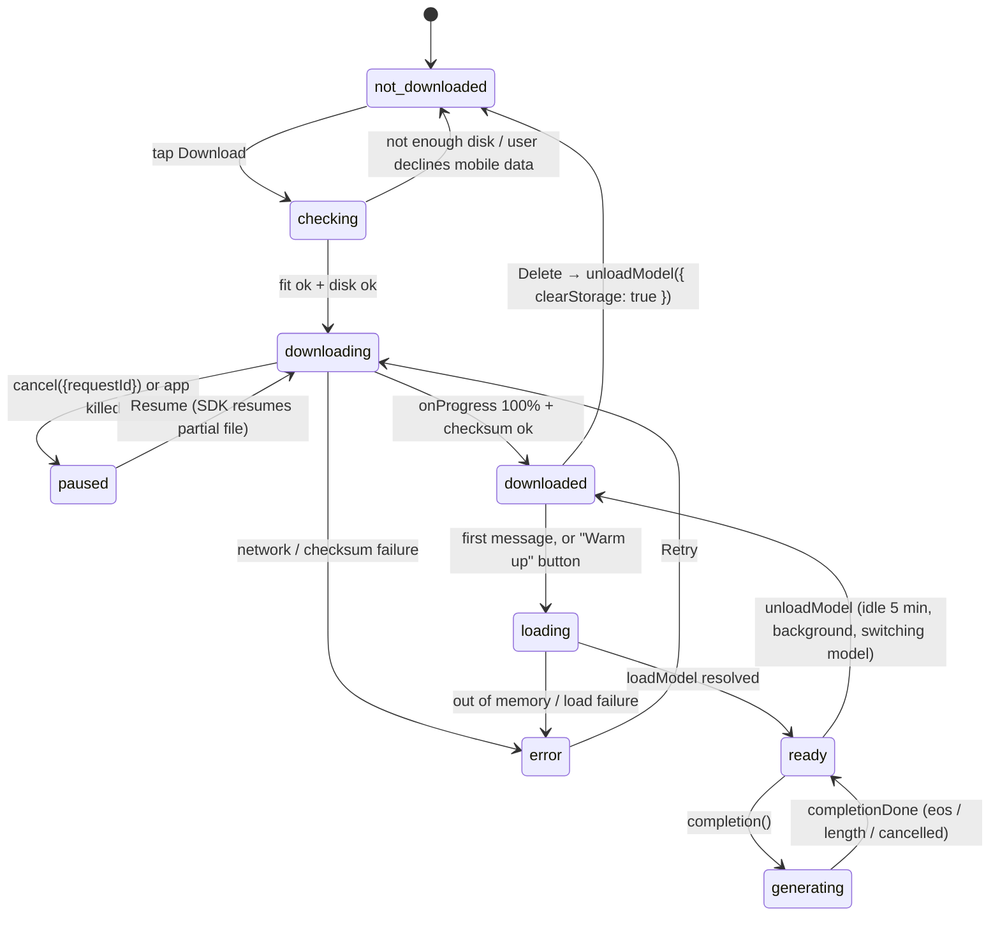
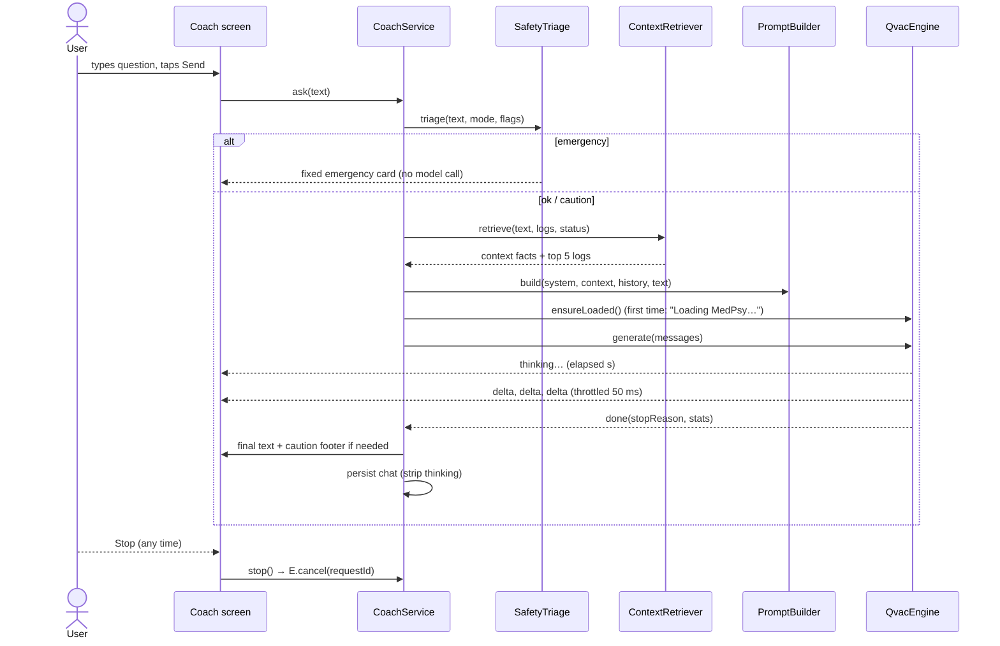

# 4. Local AI with the QVAC SDK

Goal: Luna's coach runs **QVAC MedPsy on the phone**. It works in airplane mode, sees the user's
own tracking data, streams its answer, and can be stopped. Safety rules run outside the model.

API facts below come from reading the `@qvac/sdk@0.22.0` type definitions and examples on
2026-10-27, plus the QVAC install docs. Anything not yet tested on a phone is marked **(spike)**.

## 4.1 Today vs target

| Piece | Today | Target |
|---|---|---|
| Model download | 🧪 `setInterval` fills a progress bar ([ModelManager.ts:196](../../src/services/ModelManager.ts#L196)) | `downloadAsset({ assetSrc, onProgress })` from Hugging Face, SHA-256 verified, pause/resume |
| Load into RAM | 🧪 six 180 ms sleeps ([LocalInference.ts:33](../../src/ai/LocalInference.ts#L33)) | `loadModel({ modelSrc, modelType: 'llamacpp-completion', modelConfig })` |
| Answer | 🧪 keyword templates ([InsightComposer.ts:126](../../src/ai/InsightComposer.ts#L126)) | `completion({ history, stream: true, captureThinking: true })` |
| Conversation memory | ⚠️ none: each answer sees only the last question | Last N turns within a token budget |
| Context ("RAG") | ⚠️ retrieves logs but never puts them in a prompt | Structured context block (§4.7) |
| Stop button | ⚠️ none | `cancel({ requestId })` |
| Safety | ⚠️ no emergency handling; compact replies have no disclaimer | Triage before the model + fixed flags (§4.10) |
| Desktop / network tiers | 🧪 fake peers; Tier 3 "pays" a fake wallet | Hidden in v1 (§4.14) |
| Whisper / Bergamot | 🧪 downloadable, unused | Replaced by the voice and language design in [08](08-voice-and-languages.md) (Whisper + TranslatePsy-AfriSLM + TTS). Hidden until that ships |

## 4.2 Model catalog (target)

| Id | Source (`modelSrc`) | File size | Weights + KV cache* | Role |
|---|---|---|---|---|
| `medpsy-1.7b-q4km` | SDK constant `HEALTHCARE_1_7B_MEDICAL_Q4_K_M` (registry entry for `qvac/MedPsy-1.7B-GGUF/medpsy-1.7b-q4_k_m-imat.gguf`, checksum pinned) | 1.28 GB | ≈ 1.5 GB @ 2k ctx · ≈ 1.75 GB @ 4k | **Default coach.** The "sweet spot for smartphones" per the MedPsy quantization study (−1.1% vs BF16) |
| `medpsy-4b-q4km` | SDK constant `HEALTHCARE_4B_MEDICAL_Q4_K_M` | 2.72 GB | ≈ 3.0 GB @ 2k · ≈ 3.3 GB @ 4k | Flagship phones only (shown when `assessModelFit` says `likely-fits`) |
| `qwen3-0.6b` | SDK constant `QWEN3_600M_INST_Q4` | ≈ 0.4 GB (spike: read `p.total`) | small | Low-RAM fallback **and the Phase 0 spike model** (fast download). General model, not medical; labelled as such |

\* KV cache computed from the Qwen3 configs that MedPsy inherits: 1.7B = 28 layers × 8 KV heads × 128 dim = 112 KB/token (f16); 4B = 36 layers → 144 KB/token. Add runtime overhead.

Rules:
- **Never** offer 3-bit quantizations of MedPsy 1.7B. The model's own safety doc says they degrade
  medical accuracy severely.
- Prefer the SDK registry constants: they pin the exact file revision and checksum, and the
  registry can also serve them peer-to-peer. A raw Hugging Face URL also works (the SDK verifies
  it against the Hub's SHA-256; set `requireHttpChecksum: true` so an unverifiable download is refused).
- The catalog is a constant in `ModelManager`. The registry (`luna:models`) stores only status,
  `modelId` and `downloadedAt`.

## 4.3 Model lifecycle



Registry status values: `not_downloaded | downloading{progress} | paused{progress} | downloaded | error{message}`.
Runtime-only status (memory, not persisted): `loading | ready | generating`.

On app start, `ModelManager.init()` turns any persisted `downloading` into `paused` (today it resets
to `not_downloaded` and loses progress ⚠️). Reconciling the registry with the SDK cache is **(spike)**:
check whether `getModelInfo` reports cached files.

## 4.4 Device checks before downloading

1. **Fit:** `assessModelFit({ models: [{ modelSrc, modelType: 'llamacpp-completion', modelConfig: { ctx_size } }], policy: 'interactive-v1' })`.
   Verdicts: `likely-fits` → allow · `likely-too-large` → disable with a reason · `unknown` → allow with a warning.
   This replaces the hard-coded `minRamBytes` table in [ModelManager.ts:89](../../src/services/ModelManager.ts#L89).
2. **Disk:** free space ≥ file size × 1.2 (use the `expo-file-system` free-space API for SDK 57; check the versioned docs).
3. **Network:** warn before a 1.3 GB download on mobile data (`expo-network` type `CELLULAR`).
4. **Context size:** `ctx_size: 4096` if the 4k check fits, else `2048`.

## 4.5 Engine interface

```ts
// src/ai/engine/InferenceEngine.ts
export type EngineEvent =
  | { type: 'loading'; progress?: number }
  | { type: 'thinking'; elapsedMs: number }          // model is reasoning; text hidden
  | { type: 'delta'; text: string }                  // visible answer text
  | { type: 'done'; stopReason: 'eos' | 'length' | 'cancelled'; stats?: { tokensPerSecond?: number; ttftMs?: number } };

export interface InferenceEngine {
  readonly kind: 'qvac' | 'demo';
  activeModel(): ModelInfo | null;
  ensureLoaded(onProgress?: (p: number) => void): Promise<void>;
  generate(req: { messages: ChatTurn[]; params: GenParams }, onEvent: (e: EngineEvent) => void): { requestId: string; done: Promise<string> };
  cancel(requestId: string): Promise<void>;
  unload(): Promise<void>;
}
```

`QvacEngine.generate` maps SDK events: `thinkingDelta` → `thinking`, `contentDelta` → `delta`,
`completionDone.stopReason` → `done` (SDK `undefined` = natural end = `eos`).
`DemoEngine` wraps today's `composeReply` behind the same interface, so the UI has one code path.

## 4.6 One coach turn



## 4.7 Prompt design

**System message** (the template already prepends "You are MedPsy, a medical and healthcare AI
assistant developed by QVAC."; ours is appended after it):

```
You are Luna inside the LunaPredict app, speaking to {name}. You run fully on their phone; nothing leaves it.
Mode: {mode_description}.
Rules:
- Use the FACTS below for anything about this user's cycle, pregnancy or logs. Never invent dates, numbers or history that are not in FACTS. If FACTS lack something, say so.
- Answer in plain, warm English. At most 120 words. Short paragraphs or up to 4 bullets.
- You are not a doctor. Do not diagnose. Suggest seeing a clinician when symptoms are severe, persistent or unusual.
- Never give prescription doses. Over-the-counter advice must say "as directed on the label".
- This app is not contraception; never say a day is "safe" for unprotected sex.
FACTS:
{facts_block}
```

**Facts block** (built by `ContextRetriever` from domain outputs, never from model output):

```
today: 2026-10-27
cycle: day 23 of ~28 (learned from 4 cycles, regular, ±1 day); phase luteal
next period: 2026-10-31 (range Oct 30–Nov 1)
ovulation: 2026-10-17 (confirmed by BBT)
status flags: none
last 7 days: fatigue ×3, cramps ×1, mood stressed ×2, energy low ×3, sleep poor ×2
relevant logs:
- 2026-10-25: symptoms fatigue,bloating; mood down; energy low; notes "long shift"
- …(max 5, chosen by keyword + recency score)
```

Partner coach uses the same pipeline with a partner system prompt, and FACTS contain **only** the
fields in the received `SharedSnapshot`.

**Token budget** (`ctx_size` 4096): system + facts ≤ 700 tokens · history ≤ 1,200 (most recent
turns, never cut mid-message) · question ≤ 300 · generation budget `predict` (below). At 2048 ctx,
halve history and use the short answer budget.

**Generation params** (from the MedPsy integration guide): `temp 0.6, top_p 0.95, top_k 20`, plus
`reasoning_budget` from §4.8. `predict`: 1,024 when thinking is on (the guide warns that thinking is
cut off below 1,024–2,048); 384 when thinking is off.

**Chat history stored** = visible content only (`final.contentText`). Thinking text is never
stored or re-sent.

## 4.8 Thinking (the biggest speed risk)

MedPsy is trained on Qwen3 thinking backbones and writes a `<think>…</think>` block before answering.
On a phone this can mean hundreds of tokens of hidden work before the first visible word.

- **The SDK can switch thinking off per request:** `generationParams.reasoning_budget`. The schema
  says `-1` keeps reasoning on, `0` disables it, and a positive number caps it at that many tokens.
  The SDK itself uses `reasoning_budget: 0` for its TranslatePsy translations.
- Always set `captureThinking: true` as well, so any thinking that does happen arrives as
  `thinkingDelta` events and never appears in the bubble. The UI shows "Luna is thinking… 12 s".
- **(spike)** Measure on the phone: time to first visible token, tokens/s and answer quality for
  (A) `reasoning_budget: 0`, (B) a capped budget such as `256`, and (C) `-1` (full thinking).
  Pick the fastest option whose answers stay correct on the 10 golden questions in
  [06 §6.3](06-testing-and-e2e.md#63-ai-golden-questions). MedPsy was trained to think, so
  check that (A) doesn't hurt accuracy. (B) is the likely middle ground.
- If time to first visible token stays above ~20 s on a mid-range phone, offer the Qwen3 0.6B
  "quick answers" model as a speed option and keep MedPsy as "thorough".

## 4.9 Expo & native setup

QVAC needs native code, so the coach runs in a **development build**, not Expo Go. Requirements
from the QVAC install guide: Expo ≥ 54, Node `^22.21 || ≥ 24.9` (this machine: 24.11 ✅), npm ≥ 10.9,
a **physical device** (no emulators), Android `minSdkVersion` 29.

```bash
npm i @qvac/sdk react-native-bare-kit@^0.16.0
npx expo install expo-file-system expo-build-properties expo-device expo-dev-client expo-network expo-secure-store
```

`app.json` additions:

```json
{
  "expo": {
    "plugins": [
      "expo-status-bar",
      ["expo-build-properties", { "android": { "minSdkVersion": 29 } }],
      ["@qvac/sdk/expo-plugin", { "installMissingPrebuilds": true }]
    ]
  }
}
```

`qvac.config.json` (bundle only the LLM plugin; add embeddings later if needed):

```json
{ "plugins": ["@qvac/sdk/llamacpp-completion/plugin"] }
```

`eas.json`: add a `development` profile (`"developmentClient": true, "distribution": "internal",
"android": { "buildType": "apk" }`). Build in the cloud (no Android SDK needed on Windows), install
the APK, then run `npx expo start --dev-client`. JS changes still hot-reload. Rebuild only when native
dependencies change. Re-run prebuild after any reinstall, because reinstalling clears the native
addon links (per the QVAC docs).

**Compatibility risk (spike):** QVAC's Expo tutorial targets SDK 54 / RN 0.81. We are on SDK 57 / RN 0.86.
If `react-native-bare-kit` fails to build or load, the options are: (1) check for newer
`react-native-bare-kit` / `@qvac/sdk` releases, (2) report it to QVAC, (3) as a last resort run
a separate SDK 54 spike app to unblock the demo. Don't downgrade the main app without a decision.

## 4.10 Safety layer

Runs **before** the model, in plain code. The model can't override it.

| Level | Example triggers (case-insensitive, pattern-matched) | Behaviour |
|---|---|---|
| `emergency` | chest pain, can't breathe, fainting/passed out, suicidal or self-harm phrasing, soaking a pad every hour, heavy bleeding while pregnant, severe headache with vision changes in pregnancy, seizure | **No model call.** Red card: "This could be an emergency. Call your local emergency number now (Kenya: 999 or 112)." Plus one line of what to do while waiting |
| `urgent` | one-sided pelvic pain + late period, fever + pelvic pain, reduced baby movement, bleeding after menopause | Show the urgent banner first, then let the model answer with a context line telling it to recommend same-day care |
| `caution` | medication, dose, supplement, "is it safe" | Model answers; footer "Check with a pharmacist or clinician before taking anything." |
| `ok` | everything else | Model answers; small persistent footer "AI guidance, not medical advice." |

Plus: active health flags (A10) appear above the chat and in FACTS, and the urgent ones also appear
on the Dashboard. Emergency numbers live in a per-locale table; default Kenya 999/112, fallback
"your local emergency number".

## 4.11 App lifecycle & memory

- Load lazily on the first message. Offer a "Warm up" button on the Models screen.
- Keep the model loaded while the Coach tab is used. Unload after 5 minutes idle, or 60 s after the
  app goes to the background (`AppState`). Android may kill a backgrounded app holding ~1.7 GB.
- One generation at a time. Send is disabled while generating, and Stop is shown instead.
- Leaving the Coach tab doesn't cancel generation, but switching mode or clearing the chat does.
- Throttle UI updates to about every 50 ms (batch deltas) so long answers don't cause a re-render per token.

## 4.12 Errors & recovery

| Failure | Detection | User sees | Recovery |
|---|---|---|---|
| No model downloaded | registry | Coach empty state: "Download MedPsy (1.3 GB) to chat offline" + button | Models screen |
| Download network loss | `downloadAsset` rejects | Card shows "Paused — no connection" | Resume button / auto-resume when online |
| Checksum failure | SDK error | "Download corrupted, retrying" | Delete partial (`cancel({ clearCache: true })`), retry once |
| Out of memory on load | `loadModel` rejects | "Not enough free memory — close other apps or use the smaller model" | Offer Qwen3 0.6B |
| Generation hits `predict` limit | `stopReason: 'length'` | Answer + "(cut short)" + Continue button | Re-ask with "continue" |
| Native module missing (Expo Go) | `engine.kind === 'demo'` | Persistent "Demo mode" badge | Install the dev build |

## 4.13 Context retrieval (RAG)

v1 uses **structured retrieval**, not embeddings: the data is typed (dates, symptom ids, flow), and
the facts block above is more precise than vector search over a few hundred short logs. Keep today's
keyword + recency scorer for picking up to 5 logs, filtered to the current mode, with notes included.

v2 (optional): when users write long notes, add QVAC's on-device RAG (`ragIngest` / `ragSearch`
with an embedding model and the `llamacpp-embedding` plugin) over **notes only**. It costs an extra
model download, so do it only if v1 misses things in the golden tests.

## 4.14 P2P tiers (desktop / network)

The SDK 0.22 types contain **no** "delegate this completion to my desktop" API. What exists is a
llama.cpp **RPC server** (`startRpcServer` with `discoveryTopic`, `discoverRpcServers`). It is meant
for splitting a model across machines on a private network, and needs explicit non-loopback opt-in.
Whether a phone can use a desktop this way is unproven.

Decision for v1: **hide** "My desktop" and "Public network" in the Coach, and hide the pay-per-token
wallet flow. Keep the code behind a `labs` flag. Revisit with a separate spike once on-device works.
Showing fake peers next to real on-device AI would undermine the app's honesty.

## 4.15 Phase 0 spike: go/no-go

1. Branch `spike/qvac`. Install as in §4.9 and add the `development` EAS profile.
2. `eas build --profile development --platform android` → install the APK on your phone.
3. A hidden debug screen with three buttons:
   - Download `QWEN3_600M_INST_Q4` (shows MB progress) → Load → Ask "Say hi in one word".
   - Same with MedPsy 1.7B Q4_K_M (`HEALTHCARE_1_7B_MEDICAL_Q4_K_M`), with `reasoning_budget` 0 / 256 / −1.
   - Cancel mid-download, kill the app, reopen → Resume.
4. Record: download MB/s, load time, time to first thinking token, time to first visible token,
   tokens/s, peak RAM (Android Studio profiler or `getSystemResources`), and the stop reason.

**Go** if MedPsy 1.7B loads and answers on your phone, and the first visible token arrives in
under ~20 s with the best §4.8 option. **No-go** → see the compatibility options in §4.9.
