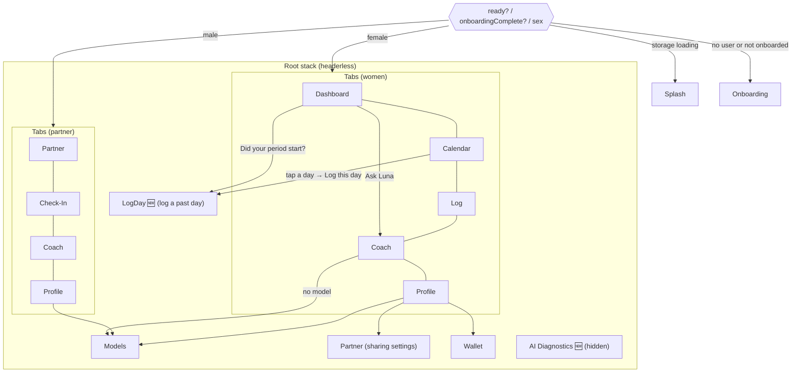
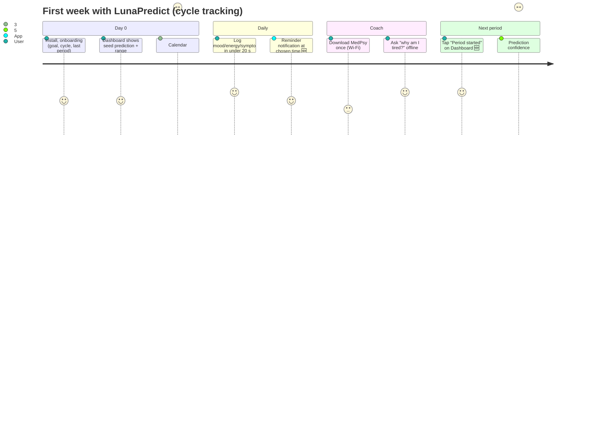
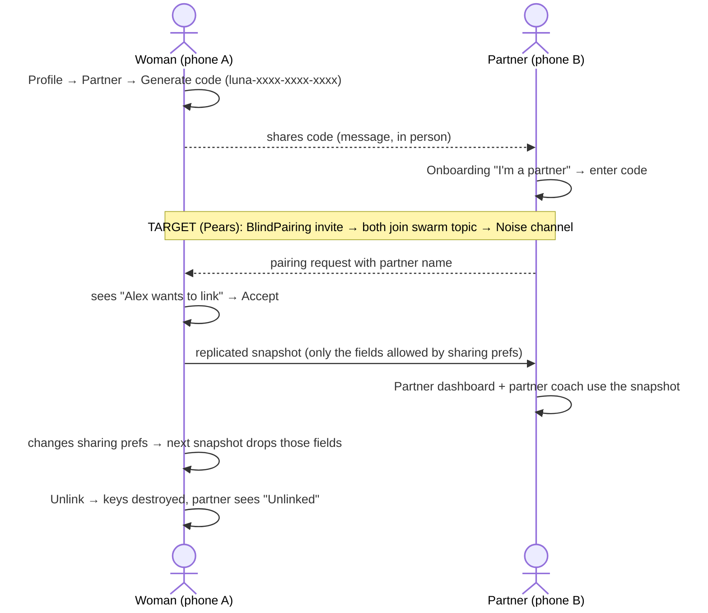

# 5. Navigation & User Flows

Source: [src/navigation/AppNavigator.tsx](../../src/navigation/AppNavigator.tsx).

## 5.1 Route map

**Gating rules**

| Rule | Today | Target |
|---|---|---|
| Splash until storage is hydrated | ✅ | ✅ |
| Onboarding until `onboardingComplete` | ✅ | ✅ |
| Sex picks the tab set | ✅ | ✅ |
| `Wallet` reachable only from women's Profile | ✅ | Behind a `labs` flag in v1 ([04 §4.14](04-local-ai-qvac.md#414-p2p-tiers-desktop--network)) |
| Mode = pregnancy requires a due date | ⚠️ not enforced (Profile switch skips it) | Mode switch opens a mini setup sheet |
| `Partner` stack screen for women only | ✅ (only linked from women's Profile) | ✅ |

**Typing:** `RootStackParamList` covers the stack. Tab navigators are untyped
(`NavigationProp<{ Log: undefined; Coach: undefined }>` is hand-written in screens). Add typed tab
param lists, and `LogDay: { day: LogDay }`.

## 5.2 Women's journey (period / conceive)

Key end-to-end behaviours:

1. **Seed → learn.** Onboarding seed → first logged period → `learning` → 3 regular cycles → `established`.
2. **Late period.** The Dashboard switches to "Period N days late" and offers "Did it start?"; conceive mode adds the pregnancy-test hint ([03 A4](03-tracking-algorithms.md#a4-late-period-and-missed-logs)).
3. **Conceive.** Logging OPK/BBT/mucus moves ovulation from `predicted` to `likely` to `confirmed`, and the Calendar marks it.
4. **Becoming pregnant.** Conceive → "I'm pregnant" → enter LMP or due date → pregnancy mode.
5. **Coach.** Uses the same facts shown on screen, so the chat and the dashboard never disagree.

## 5.3 Pregnancy journey

Onboarding (weeks pregnant) → Dashboard: week + day, trimester, size, days to due date → daily
log (symptoms, sleep, kick sessions ≥ 28w) → urgent flags (bleeding, reduced movement) → "Pregnancy ended"
(birth or loss) → period mode with seed confidence.

## 5.4 Perimenopause journey

Onboarding (months since last period) → Dashboard shows the stage (STRAW+10), days since last
period, variability, and hot-flash trend. No date countdown → log hot flashes, sleep and flow →
12 months without bleeding = postmenopause milestone → any later bleeding = flag.

## 5.5 Partner journey (two phones)

**Today** 🧪: pairing doesn't connect the phones. The woman types the partner's name to "confirm",
and the partner's phone **invents** a snapshot from the code's hash. On two real phones, the
partner sees made-up data. Until real sync exists, the partner screens must say "Demo data"
([routes/partner-dashboard.md](routes/partner-dashboard.md)).

**Path to real sync:** the QVAC setup adds `react-native-bare-kit`, which can run a separate Bare
worklet with Hyperswarm and BlindPairing. That makes real P2P partner sync feasible in a later phase
**(spike)**.

## 5.6 Mode switching matrix (women, Profile → Current goal)

| From → To | Must ask | Data kept |
|---|---|---|
| period ↔ conceive | nothing | everything (same cycle engine; conceive shows extra fields) |
| period/conceive → pregnancy | LMP or due date | logs kept; cycle predictions hidden |
| pregnancy → period | "Pregnancy ended" date + outcome | pregnancy archived on the profile; cycle confidence → seed |
| any → perimenopause | last period (months ago) | logs kept; date predictions off |
| perimenopause → period | confirm last period start | logs kept |

Today all switches are a single tap with no follow-up questions ⚠️. Mode changes also reset the
coach chat, which is intended but should ask for confirmation if a reply is streaming.
