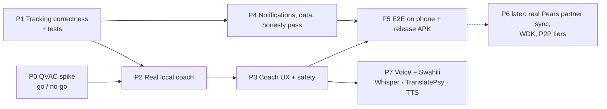

# 7. Implementation Plan

Phases are ordered by risk: prove QVAC on the phone first, fix tracking correctness next, then
build the real coach on top. Each phase ends with something you can install and test on your phone.

P0 and P1 can run in parallel: P0 is native and build work, P1 is pure TypeScript.

## P0 — QVAC spike (go/no-go)
Details: [04 §4.15](04-local-ai-qvac.md#415-phase-0-spike-gono-go).
- Branch `spike/qvac`; install the SDK and plugins; add the `development` EAS profile; build the APK.
- Debug screen: download / load / ask / cancel / resume for Qwen3 0.6B, then MedPsy 1.7B.
- Measure the thinking options (A/B/C in [04 §4.8](04-local-ai-qvac.md#48-thinking-the-biggest-speed-risk)).

**Done when:** MedPsy 1.7B answers on your phone in airplane mode, the measurements are written into
04 §4.8, and the go/no-go decision is recorded.

## P1 — Tracking correctness (TDD)
1. Add Jest + `jest-expo`; write vectors V1–V12 as failing tests.
2. Schema v2: `day` + `loggedAt`, migration, `periodStart` / `periodEnd` ([02](02-data-and-storage.md#the-date-bug)).
3. Move the engine to `src/domain/`; implement A1–A5 and A7 (episodes, spotting rule, median + spread, missed-log guard, late state, 6-day window).
4. A6 ovulation detection (OPK, BBT 3-over-6, mucus), A8 pregnancy fixes, A9 peri staging, A10 flags.
5. LogDay route: log or edit any past day from the Calendar, and "Period started / ended" quick actions.
6. Mode-switch setup sheet (pregnancy needs LMP or due date; pregnancy ended → outcome).

**Done when:** all vectors pass; checklist blocks A, B and D pass on the phone.

## P2 — Real local coach
1. `InferenceEngine` interface; `QvacEngine` + `DemoEngine`; runtime selection ([01 §1.4](01-system-architecture.md#14-build-modes)).
2. `ModelManager` on `downloadAsset` / `loadModel` / `unloadModel({ clearStorage })`, the lifecycle in [04 §4.3](04-local-ai-qvac.md#43-model-lifecycle), `assessModelFit`, disk and network checks. Real catalog (§4.2); hide Whisper and Bergamot.
3. `ContextRetriever` facts block + `PromptBuilder` with token budgets and history.
4. `CoachService` orchestrating triage → retrieve → build → generate → persist.

**Done when:** checklist block C passes; golden questions 1–5 and 8 pass.

## P3 — Coach UX & safety
1. `SafetyTriage` with emergency, urgent, caution and ok levels; emergency card; per-locale numbers.
2. Stop, Retry, "Continue" for `stopReason: 'length'`, the thinking indicator with elapsed time, throttled streaming.
3. `FlatList` with stable message ids; fix the Android keyboard covering the input; empty and error states.
4. Hide the desktop and network tiers and the wallet behind `labs`.
5. Partner coach on the same pipeline, with facts restricted to the snapshot.

**Done when:** golden questions 6, 7, 9 and 10 pass, and the Maestro coach flow passes.

## P4 — Platform & honesty pass
1. `resetApp` resets every singleton and offers to delete models; Export → share sheet file.
2. Mnemonic → `expo-secure-store` (even while the wallet is in labs).
3. Local notifications (`expo-notifications`): period due (N days before, from the range start), daily check-in at the chosen time, rescheduled whenever predictions change.
4. Copy pass: remove claims that aren't true ("added to your on-device RAG index", "P2P SYNCED" on demo data, "QVAC READY" when on demo); add "Demo data" labels on partner screens; add "Not contraception" on fertility views.
5. `npx expo install --fix` (6 packages are behind SDK 57).

**Done when:** checklist blocks E (demo-labelled) and F pass.

## P5 — Release candidate
Run the full checklist §6.4 on at least two phones (one mid-range, around 4–6 GB RAM, and one flagship).
Build `preview` APK; update the `/download` page.

## P6 — Later (each needs its own spike)
- Real partner sync over Pears (a Bare worklet via `react-native-bare-kit`: BlindPairing + Hyperswarm + Hypercore).
- Real WDK wallet (BIP39 via WDK secret manager, real chain modules), only if a paid compute network exists.
- Desktop delegation over the QVAC RPC server, if it proves usable from a phone.

## P7 — Voice & African languages
Full design: [08](08-voice-and-languages.md). Starts once P3 (English coach + safety) is done, and can
run alongside P4/P5.
- V0 spike: record → Whisper (sw) → TranslatePsy → MedPsy → TranslatePsy → speak, timed on the phone.
- V1 typed Swahili chat · V2 voice input · V3 voice output · V4 voice logging with confirmation.

**Done when:** golden questions 1–7 asked in Swahili (typed and spoken) give correct, safe answers
in airplane mode, and the Swahili emergency card shows for the reviewed emergency phrases.

## Risks

| Risk | Impact | Mitigation |
|---|---|---|
| `react-native-bare-kit` incompatible with SDK 57 / RN 0.86 | Blocks real AI | P0 first; options in [04 §4.9](04-local-ai-qvac.md#49-expo--native-setup) |
| Thinking makes answers slow on mid-range phones | Bad UX | `reasoning_budget` 0 or a cap (SDK supports it); P0 measures the quality trade-off; Qwen3 0.6B quick mode |
| Machine translation changes a medical detail | Harm | Two-language triage, human-written emergency cards, numbers check, "Show English" ([08 §8.8](08-voice-and-languages.md#88-safety-with-translation)) |
| 1.3 GB download on mobile data | Users abandon | Wi-Fi warning, resume, clear size shown up front |
| Android kills the app while the model is loaded | Lost answer | Unload in background; persist the partial answer; reload on return |
| Model gives unsafe advice | Harm | Triage before the model, flags it can't override, golden tests, visible disclaimer |
