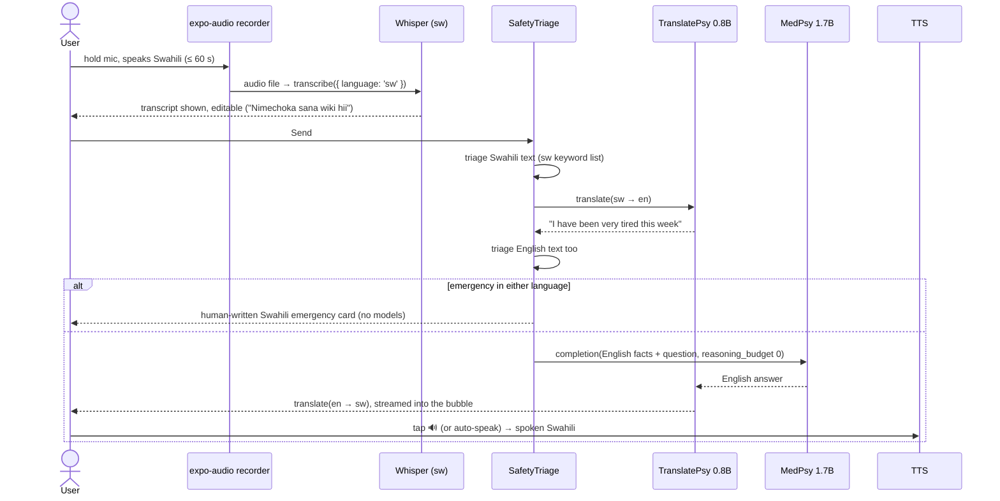

# 8. Voice & African Languages (TranslatePsy-AfriSLM)

**Question:** can we add [TranslatePsy-AfriSLM](https://huggingface.co/collections/qvac/translatepsy-afrislm)
so Luna works by voice and in African languages?

**Answer: yes.** TranslatePsy is a **text translation** model, not a voice model. Voice needs three
on-device pieces, and the QVAC SDK 0.22 registry ships all of them:

| Job | Model | QVAC API |
|---|---|---|
| Speech → text | Whisper (whisper.cpp) | `transcribe()` |
| Swahili ↔ English (and 18 more) | **TranslatePsy-AfriSLM** | `translate()`. The SDK has built-in TranslatePsy prompt handling |
| Text → speech | Chatterbox multilingual (has Swahili), or the phone's own TTS | `textToSpeech()` / `expo-speech` |

All run in the same QVAC worker as MedPsy, with the same download → load → run → unload
lifecycle as [04](04-local-ai-qvac.md). Facts come from the model cards and the `@qvac/sdk` /
`@qvac/inference` 0.22.0 package contents (read 2026-10-27). Items marked **(spike)** need a phone test.

## 8.1 Why translation is needed at all

MedPsy is **English-only** ("Performance in other languages is not validated", from the MedPsy
safety doc). So a Swahili speaker's question must become English before MedPsy sees it, and the
answer must come back in Swahili. TranslatePsy is built for exactly this pair, and the paper says it
beats much larger systems (TranslateGemma-27B, Qwen3.5-122B) on African translation benchmarks.

## 8.2 What's in the collection

| Model | Base | File (Q4_K_M) | SDK constant |
|---|---|---|---|
| TranslatePsy-AfriSLM-0.8B | Qwen3.5-0.8B | **641 MB** | `TRANSLATEPSY_AFRISLM_0_8B_TRANSLATION_Q4_K_M` |
| TranslatePsy-AfriSLM-2B | Qwen3.5-2B | 1,488 MB | `TRANSLATEPSY_AFRISLM_2B_TRANSLATION_Q4_K_M` |
| TranslatePsy-AfriSLM-4B | Qwen3.5-4B | 2,924 MB | `TRANSLATEPSY_AFRISLM_4B_TRANSLATION_Q4_K_M` |

Q8_0 variants exist too. Apache 2.0 licence, not gated. Quality loss from Q4 is small (0.8B
Flores-200 SSA-COMET 0.5944 → 0.5886). **Recommendation:** 0.8B Q4 on phones, 2B on flagships.

Languages (English ↔): Afrikaans, Amharic, Hausa, Igbo, Kinyarwanda, Lingala, Luganda, Malagasy,
Nyanja, Oromo, Shona, Somali, Southern Sotho, **Swahili**, Tswana, Wolof, Xhosa, Yoruba, Zulu.

The SDK sends TranslatePsy the model card's exact prompt with `temp 0, predict 256,
reasoning_budget 0` (`translatepsy-utils.js`). We don't write translation prompts ourselves.

> The model card says it is **not validated for autonomous medical or emergency use**. The safety
> rules in §8.8 exist because of this.

## 8.3 Voice turn pipeline (Swahili example)



Typing in Swahili is the same flow without the microphone and Whisper. The bubble keeps the
English original behind a "Show English" toggle, labelled "Machine-translated".

**Shortcut for low-RAM phones:** Whisper can output English directly (`translate: true` option)
and skip the inbound TranslatePsy step. It's lower quality, so use it only when the device can't
hold TranslatePsy and MedPsy together.

## 8.4 Language support matrix

Voice input depends on Whisper, which covers only some of TranslatePsy's languages. Whisper's
quality on African languages is weak: secondary sources report about 34% word error rate for
Swahili and 49% for Yoruba on FLEURS with large-v3, and smaller Whisper models are worse.

| Language | Typed chat (TranslatePsy) | Voice in (Whisper) | Voice out |
|---|---|---|---|
| English | ✅ native | ✅ good | ✅ Chatterbox / OS |
| **Swahili** | ✅ | ⚠️ usable, needs testing (spike) | ✅ Chatterbox `sw`; OS TTS varies by phone |
| Afrikaans | ✅ | ✅ (close to Dutch) | OS TTS only |
| Amharic, Hausa, Yoruba, Somali, Shona, Lingala, Malagasy | ✅ | ⚠️ supported but weak, "experimental" | OS TTS only, if installed |
| Igbo, Kinyarwanda, Luganda, Nyanja, Oromo, Sotho, Tswana, Wolof, Xhosa, Zulu | ✅ | ❌ not in Whisper | OS TTS only, if installed |

**v1 scope: English + Swahili, full voice.** Offer typed chat in all 19 languages, labelled "beta".
Later: a fine-tuned African Whisper (e.g. Sunbird's 51-language large-v3 fine-tune) converted to
whisper.cpp format could be loaded from a URL **(spike: format conversion, 1.5 GB size)**.

## 8.5 Models, sizes, memory

| Pack | Contents | Download |
|---|---|---|
| Coach (required) | MedPsy 1.7B Q4_K_M (`HEALTHCARE_1_7B_MEDICAL_Q4_K_M`) | 1.28 GB |
| **Swahili pack** | TranslatePsy 0.8B Q4 + Whisper small Q8 (`WHISPER_SMALL_Q8_0`, 252 MB) | ≈ 0.9 GB |
| Natural voice (optional) | Chatterbox multilingual Q4: `TTS_T3_MULTILINGUAL_CHATTERBOX_Q4_0` (329 MB) + `TTS_S3GEN_MULTILINGUAL_CHATTERBOX_Q4_0` (≈ 750 MB, spike: confirm) | ≈ 1.1 GB |
| Phone voice (default) | `expo-speech` → Android's built-in TTS | 0 MB |
| Best-quality ASR (flagship) | `WHISPER_LARGE_V3_TURBO` | 1.55 GB |

**Memory plan:** never hold everything at once.

- Whisper: load → transcribe → **unload** (unless the phone has ≥ 8 GB RAM).
- TranslatePsy (≈ 0.7 GB with a 2k context) and MedPsy (≈ 1.5–1.75 GB) stay resident together
  during a Swahili conversation, ≈ 2.4 GB. Check with
  `assessModelFit({ models: [...], execution: 'concurrent' })`. If it doesn't fit, swap them per
  turn (slower).
- Chatterbox loads only when the user taps 🔊 with "natural voice" on.

## 8.6 Latency budget (measure in the spike)

| Stage | Target on a mid-range phone |
|---|---|
| Whisper small, 10 s of speech | ≤ 4 s |
| Translate question (≈ 30 tokens) | ≤ 2 s |
| MedPsy answer, thinking off (≈ 150 tokens) | first word ≤ 3 s, total ≤ 15 s |
| Translate answer (≈ 200 tokens), streamed | first word ≤ 2 s |
| TTS first audio | ≤ 2 s (OS) |

Show progress per stage in the bubble: "Listening… → Transcribing… → Thinking… → Translating…".

## 8.7 SDK calls (sketch)

```ts
import {
  loadModel, unloadModel, transcribe, translate, completion,
  WHISPER_SMALL_Q8_0, TRANSLATEPSY_AFRISLM_0_8B_TRANSLATION_Q4_K_M, HEALTHCARE_1_7B_MEDICAL_Q4_K_M,
} from '@qvac/sdk';

// 1. Speech → text (language pinning option placement: spike)
const asr = await loadModel({ modelSrc: WHISPER_SMALL_Q8_0, modelConfig: { language: 'sw' } });
const swText = await transcribe({ modelId: asr, audioChunk: recordingPath });
await unloadModel({ modelId: asr });

// 2. sw → en (the SDK applies TranslatePsy's own prompt)
const tr = await loadModel({ modelSrc: TRANSLATEPSY_AFRISLM_0_8B_TRANSLATION_Q4_K_M });
const enQ = await translate({ modelId: tr, text: swText, from: 'swh_Latn', to: 'en', modelType: 'llm', stream: false });

// 3. English coach turn, thinking disabled for speed
const run = completion({ modelId: medpsy, history, stream: true, captureThinking: true,
  generationParams: { reasoning_budget: 0, temp: 0.6, top_p: 0.95, top_k: 20 } });

// 4. en → sw, streamed into the bubble
const out = translate({ modelId: tr, text: englishAnswer, from: 'en', to: 'swh_Latn', modelType: 'llm' });
for await (const t of out.tokenStream) appendToBubble(t);
```

`qvac.config.json` gains the plugins `@qvac/sdk/whispercpp-transcription/plugin` and (if
Chatterbox) `@qvac/sdk/tts-ggml/plugin`. Translation runs on the existing `llamacpp-completion`
plugin, because TranslatePsy is an LLM.

**Audio capture (spike):** record with `expo-audio` (adds the `RECORD_AUDIO` permission). Android
records compressed audio (m4a/AAC), so keep QVAC's FFmpeg audio decoder bundled (the default). Measure
the APK size cost. Raw-PCM streaming (`transcribeStream`) is a later optimisation.

## 8.8 Safety with translation

1. **Triage runs twice:** on the original-language text (a Swahili keyword list) **and** on the
   English translation. Either one triggers the emergency card.
2. **Emergency cards are human-written per language**, never machine-translated. Draft Swahili
   seed terms, **to be reviewed by a native speaker before shipping**: *damu nyingi* (heavy
   bleeding), *kutokwa na damu* (bleeding), *maumivu ya kifua* (chest pain), *siwezi kupumua*
   (can't breathe), *kuzimia* (fainting), *kujiua* (suicide), *kujidhuru* (self-harm),
   *mtoto hachezi* (baby not moving).
3. **Numbers check:** every number and date in the English answer must appear in the
   translation. If any is missing or changed, show the English answer with a note.
4. Every translated bubble carries a "Machine-translated · Show English" label.
5. Health flags and dashboard copy are written by people (string tables), not translated at runtime.

## 8.9 Voice logging (Log screen)

"Leo nina maumivu ya tumbo kidogo, nimechoka" / "Log mild cramps and low energy":

1. Mic → Whisper → (TranslatePsy → English if needed).
2. A rule-based extractor maps phrases to fields (symptom ids, mood, energy, flow, BBT number) using
   English plus a Swahili synonym table.
3. **Confirmation chips**: the Log form opens pre-filled; the user taps Save. Voice never saves directly.
4. Later: MedPsy tool calling (`generationParams.tool_choice`) to extract fields, if rules miss too much.

## 8.10 UI changes

| Where | Change |
|---|---|
| Profile | **Language**: "Luna replies in: English / Kiswahili / … (beta)" and voice output: off / phone voice / natural voice |
| Coach | Mic button (hold to talk) next to the input; stage progress; 🔊 on each answer; "Show English" |
| Log | Mic button → pre-filled form |
| Models | "Language packs" section: Swahili pack (0.9 GB), Natural voice (1.1 GB) |
| Onboarding | Language choice on the welcome step (suggest the default from the phone locale) |

The app's own buttons and labels stay English until we add i18n (`expo-localization` + reviewed
string tables). TranslatePsy can draft those strings for people to review. That's separate work.

## 8.11 Plan: phase P7 (after the coach works in English)

| Step | Deliverable | Done when |
|---|---|---|
| V0 spike | Debug screen: record → Whisper sw → TranslatePsy → MedPsy → TranslatePsy → speak | 20 Swahili phrases you record: transcripts understandable, round trip within the §8.6 budget |
| V1 | Typed Swahili chat (TranslatePsy in/out, safety §8.8) | Golden questions 1–7 asked in Swahili give correct, safe answers |
| V2 | Voice input in the Coach (English + Swahili) | Checklist: airplane mode, voice question answered |
| V3 | Voice output (OS TTS, then optional Chatterbox) | Answer is spoken in Swahili |
| V4 | Voice logging with confirmation | "log cramps and low energy" pre-fills the right chips |

## 8.12 Open questions for the spike

1. Where Whisper's `language` / `translate` options go (load-time `modelConfig` or per call), and whether VAD is on by default.
2. TranslatePsy codes for Lingala, Luganda and Wolof: the SDK's `AFRICAN_LANGUAGES_MAP` lists other languages (e.g. Tigrinya, Arabic dialects) and not these three. Test that `from: 'lin_Latn'` works.
3. Actual Chatterbox multilingual sizes and Swahili voice quality on the phone.
4. Whether `translate()` and `completion()` can share one loaded TranslatePsy instance while MedPsy is loaded (`parallel` setting).
5. APK size with FFmpeg + whisper + tts plugins vs LLM only.

## Sources
- [TranslatePsy-AfriSLM collection](https://huggingface.co/collections/qvac/translatepsy-afrislm) and the [0.8B Q4 model card](https://huggingface.co/qvac/TranslatePsy-AfriSLM-0.8B-Q4-GGUF) (languages, sizes, scores, out-of-scope uses)
- [QVAC models page](https://qvac.tether.io/products/models)
- Whisper on African languages (secondary): [convertaudiototext.com comparison](https://convertaudiototext.com/blog/best-transcription-for-african-languages); fine-tune: [Sunbird 51 African languages](https://huggingface.co/Sunbird/faster-whisper-51-african-languages)
- `@qvac/sdk` / `@qvac/inference` 0.22.0 package contents: model registry, `translate.js`, `translatepsy-utils.js`, TTS language lists
