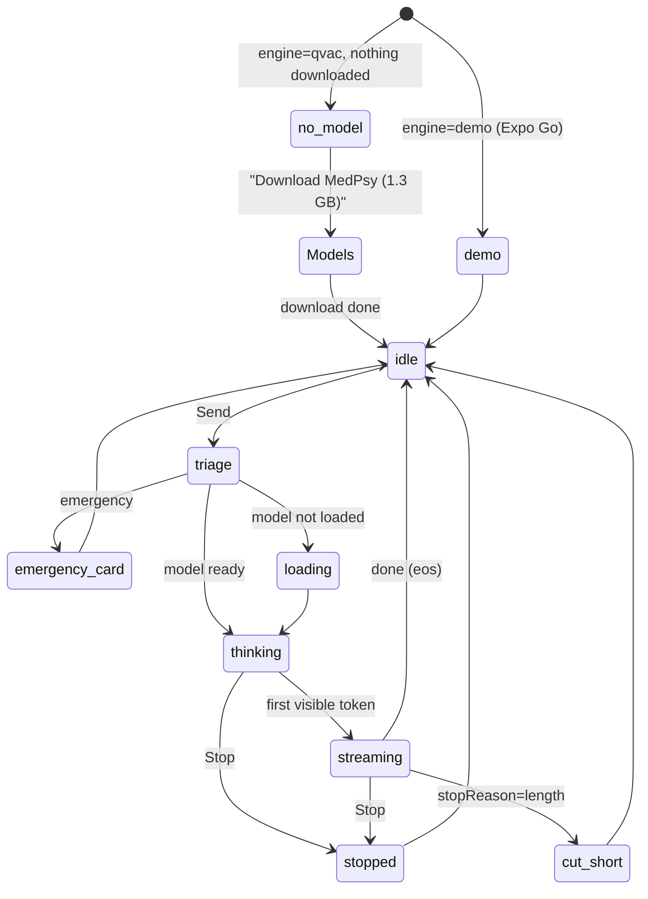

# Route: Coach (tab, women + partners)

**File:** [AICoachScreen.tsx](../../../src/screens/AICoachScreen.tsx) · Architecture: [04 Local AI](../04-local-ai-qvac.md)

## Purpose
A private chat with Luna (QVAC MedPsy on the phone) that knows the user's tracking data and
answers safely. Partners get a support-focused coach that only sees what was shared.

## States

## UI
- Header: Luna avatar, persona per mode, model chip ("MedPsy 1.7B · on-device" or "Demo mode").
- Message list (`FlatList`, stable ids, newest at bottom), suggestions for the first turn, and a
  persistent footer "AI guidance, not medical advice."
- Assistant bubble states: thinking ("Luna is thinking… 8 s"), streaming text, stopped
  ("Stopped"), cut short ("Continue"), error ("Retry").
- Composer: input + Send; while generating, Send becomes **Stop**. Long-press header → clear chat.
- Health flags strip at the top when urgent flags exist.

## Status today
- 🧪 Answers are keyword templates; downloads and loading are timers ([04 §4.1](../04-local-ai-qvac.md#41-today-vs-target)).
- ⚠️ No conversation history passed; no Stop; keys are array indexes; streaming updates re-render the whole list per word.
- ⚠️ Android keyboard: `KeyboardAvoidingView` behaviour is `undefined` on Android with a hard-coded offset of 90, so the input may hide behind the keyboard. Verify on the phone.
- ⚠️ Switching mode mid-stream: the stream keeps writing into the last message, which is now the new greeting.
- ⚠️ Hydration uses `config.greeting` captured at mount (stale after a mode change before history loads).
- ⚠️ Desktop / network tiers are fake; switching desktop → network keeps the "desktop" peer, so payments go to the wrong id ([DelegatedInference.ts:57](../../../src/ai/DelegatedInference.ts#L57)).
- ⚠️ No safety triage; local answers have no disclaimer.
- ✅ Chat persists locally (last 100); mode change resets the persona.

## Target turn pipeline
Triage → retrieve facts → build prompt (system + facts + history ≤ budget) → `generate` → stream
→ persist visible text only. Full sequence: [04 §4.6](../04-local-ai-qvac.md#46-one-coach-turn).

## Partner coach
Same pipeline; partner system prompt; FACTS = only the received snapshot fields (+ "not shared"
markers so the model says so instead of guessing). Today the partner coach is a separate template
function ([InsightComposer.ts:136](../../../src/ai/InsightComposer.ts#L136)) with a fixed 900 ms delay.

## Acceptance
Golden questions [06 §6.3](../06-testing-and-e2e.md#63-ai-golden-questions) plus:
- Airplane mode on → question 2 answers with the correct date.
- Stop during thinking → bubble shows "Stopped" within ~1 s; Send is re-enabled.
- 20-turn conversation → no crash, prompt stays within the context size, oldest turns drop.
- Keyboard open on Android → input visible above the keyboard.
- Expo Go → "Demo mode" chip visible on every assistant message.
