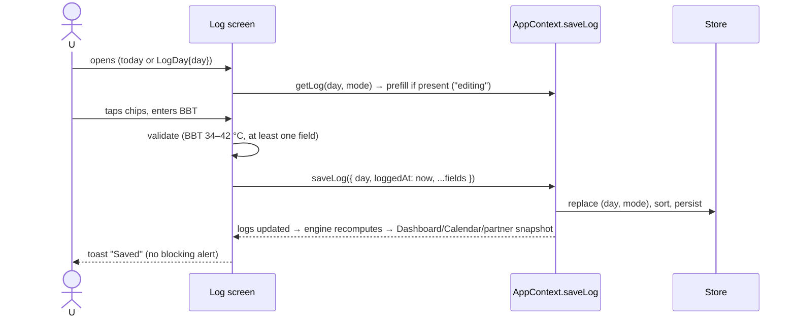

# Route: Log (women, tab 3) and LogDay 🆕

**File:** [SymptomLoggerScreen.tsx](../../../src/screens/SymptomLoggerScreen.tsx)

## Purpose
Capture a day's data in under 20 seconds. The same screen serves **today** (tab) and **any past
day** (`LogDay` stack route, opened from the Calendar or the Dashboard late banner).

## Fields per mode

| Section | Period | Conceive | Pregnancy | Peri |
|---|---|---|---|---|
| Mood, energy, symptoms, notes | ✅ | ✅ | ✅ | ✅ |
| Flow (+ Period started / ended toggles 🆕) | ✅ | ✅ | — (bleeding → urgent flag, via a "Bleeding" symptom) | ✅ |
| BBT °C | | ✅ | | |
| Cervical mucus | | ✅ | | |
| OPK | | ✅ | | |
| Kick session 🆕 (replaces counter) | | | ✅ ≥ 28w | |
| Hot flashes count | | | | ✅ |
| Sleep quality | ✅ | | ✅ | ✅ |

## Save flow

## Status today
- ✅ Mode-specific sections; prefills today's log for editing; BBT range validation.
- ⚠️ **Today only.** No date parameter, so past days can't be logged.
- ⚠️ Saves `date: new Date().toISOString()` (UTC). Can overwrite yesterday's log after midnight in UTC+ time zones ([02](../02-data-and-storage.md#the-date-bug)).
- ⚠️ Spotting and flow are one chip row; there's no explicit "period started" control.
- ⚠️ Kick "count" is a daily total; the clinical guidance is time-to-10-movements ([03 A8](../03-tracking-algorithms.md#a8-pregnancy)).
- ⚠️ Success alert claims "added to your on-device RAG index". Not true; change to "Saved — predictions updated".
- ⚠️ Voice button says to download Whisper, but there's no voice feature. Hide it until one exists.
- ⚠️ Prefill reads `Store` directly, bypassing context. Move it behind context.
- Deselecting everything on an existing log leaves the old log (save is disabled when empty). Add "Clear this day's log".

## Target additions
1. `route.params.day` (default today); header shows that date with "‹ ›" to step days (never into the future).
2. **Period started / ended** switches next to Flow (pre-set when opened from the late banner).
3. Kick session UI: Start → big tap target → shows count and elapsed time → auto-stops at 10 or 2 h → urgent flag if 2 h is reached before 10.
4. Toast instead of a blocking `Alert` after save, so logging stays fast.
5. "Clear this day" (with confirm).

## Acceptance
- Log today, change a chip, save → still one log for today (edited).
- Open LogDay for 5 days ago → save flow medium → Calendar shows it on that day.
- In UTC+3 at 01:30, open Log → today's (not yesterday's) data is shown; saving doesn't touch yesterday.
- BBT "35,9" (comma decimal) is accepted as 35.9; "45" is rejected.
