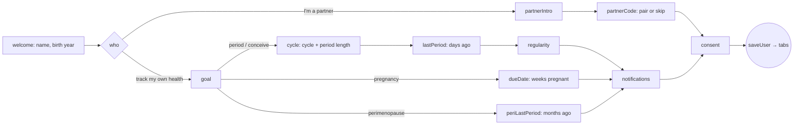

# Route: Onboarding

**Who:** everyone on first run (and after "Delete all data") · **File:** [OnboardingScreen.tsx](../../../src/screens/OnboardingScreen.tsx)

## Purpose
Collect the minimum seed data for useful predictions on day 0, pick the user's flow (woman or
partner), and get privacy consent.

## Steps

## Writes
`UserProfile`: `sex`, `mode`, `avgCycleLength`, `avgPeriodLength`, `lastPeriodStart`,
`cycleRegularity`, `dueDate`, notification prefs, and default sharing prefs (phase,
predictions and mood on; symptoms off). A partner who pairs here also writes the `PartnerLink`.

## Status today
- ✅ Branching per goal and per sex; progress bar; back navigation; consent gate.
- ✅ Seed dates use local days (`toISODay`).
- ⚠️ Notification toggles are saved, but nothing schedules notifications (P4).
- ⚠️ Perimenopause "months ago" × 30 days is stored as `lastPeriodStart`, then the normal 28-day predictor runs on it (see [03 A9](../03-tracking-algorithms.md#a9-perimenopause-staging-straw10)).
- ⚠️ "Not sure" when the last period was isn't offered; the stepper defaults to 14 days ago, which silently becomes a confident-looking seed.
- 🧪 Partner pairing here uses the simulated Pears link (see [partner-dashboard.md](partner-dashboard.md)).
- Minor: `KeyboardAvoidingView` has no Android behaviour, so check the name field isn't covered on small phones.

## Target
1. Last period: add "I don't remember" → `lastPeriodStart` undefined → Dashboard asks for the first period instead of guessing.
2. Pregnancy: let the user pick **weeks pregnant**, **LMP** or **due date** (whichever they know) → store `pregnancy.lmp` + `dueDate` ([03 A8](../03-tracking-algorithms.md#a8-pregnancy)).
3. Perimenopause: store last period, and switch the Dashboard to staging mode, not predictions.
4. Notifications step asks for permission (Android 13+ needs runtime permission) and a check-in time; schedule after `saveUser`.
5. Consent copy must stay true: "AI runs on-device" only once QVAC is live; in Expo Go, say "demo AI".
6. Add a "Not a contraceptive" line on the conceive goal card.

## Acceptance
- Period goal, 28/5, 20 days ago → Dashboard day 21, next period in 8 days, badge "From onboarding".
- Pregnancy, 12 weeks → Dashboard "12w 0d", trimester 1, due date = today + 196 days.
- Peri, 6 months → Dashboard shows "late transition", no countdown.
- Partner, valid code → Partner tab shows the linked state; invalid code → error alert, stays on step.
- Notification permission denied → onboarding still completes; Profile shows notifications as off.
