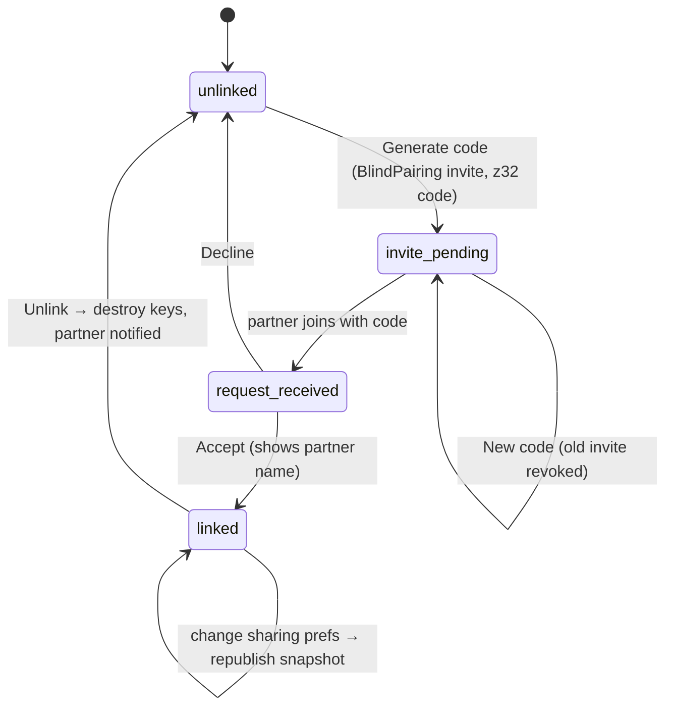

# Route: Partner sharing (women, stack)

**File:** [PartnerScreen.tsx](../../../src/screens/PartnerScreen.tsx) · Service: [PearsPartnerService.ts](../../../src/services/PearsPartnerService.ts)

## Purpose
Let a woman pair with a partner's phone, control exactly what they see, and unlink at any time.

## Flow (target, real Pears)

## What's shared (SharedSnapshot, gated per toggle)

| Toggle | Fields | Default |
|---|---|---|
| Phase | phase, phaseLabel, cycleDay | on |
| Predictions | daysUntilPeriod, nextPeriodDate, inFertileWindow | on |
| Mood | recentMood, recentEnergy | on |
| Symptoms | recentSymptoms (ids only) | off |
| Always | sharerName, mode, pregnancyWeek (if pregnant), updatedAt | — |
| Never | notes, BBT, OPK, mucus, chat, raw logs | — |

The live preview card on the screen must render from the **same function** that builds the
snapshot, so what she sees is exactly what is sent.

## Status today
- ✅ Invite code generation (z32 alphabet, SHA-256 derived topic), sharing toggles, preview, unlink.
- ✅ Snapshot republishes when the user, logs or sharing preferences change ([AppContext.tsx:84](../../../src/context/AppContext.tsx#L84)).
- 🧪 No network. "Confirm pairing" asks her to **type the partner's name**; nothing is received from the partner's phone.
- ⚠️ "Recent" mood and symptoms come from the latest log however old it is. Share only if the log is from the last 2 days, and include the log day.
- ⚠️ "CONNECTED" and "Last sync" badges imply a live connection that doesn't exist. Show "Demo" until Pears is real.
- ⚠️ Pregnancy week is always shared, with no toggle. Add a "Pregnancy progress" toggle.

## Acceptance (after real sync)
- Phone A generates a code; phone B enters it → A sees "Alex wants to link" → Accept → both show linked within 10 s on the same Wi-Fi.
- A turns Mood off → B's dashboard drops mood on the next sync.
- A unlinks → B shows "Your partner ended sharing", and the cached snapshot is deleted on B.
