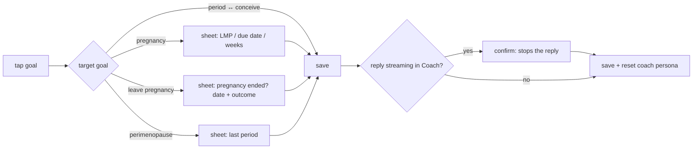

# Route: Profile (tab, women + partners)

**File:** [ProfileScreen.tsx](../../../src/screens/ProfileScreen.tsx)

## Purpose
Settings hub: current goal (women), partner sharing, AI models, notifications, export, delete.

## Sections

| Section | Women | Partners | Status |
|---|---|---|---|
| User card | ✅ | ✅ | ✅ |
| Current goal switcher | ✅ | — | ⚠️ one tap, no setup (see below) |
| Partner (link status → Partner screen) | ✅ | — | 🧪 sync is simulated |
| AI Models → Models | ✅ | ✅ | summary from the registry ✅ |
| WDK Wallet → Wallet | ✅ | — | 🧪 → move behind `labs` |
| Pair Desktop (Tier 2) | ✅ | — | 🧪 only shows an alert about a desktop app that doesn't exist → hide |
| Notifications toggles | ✅ | ✅ | ⚠️ toggles persist but schedule nothing |
| Export my data | ✅ | ✅ | ✅ clipboard JSON → target: file + share sheet |
| About | ✅ | ✅ | ✅ |
| Delete all data | ✅ | ✅ | ⚠️ doesn't reset in-memory services |

## Goal switch flow (target)

Rules: [05 §5.6](../05-navigation-and-user-flows.md#56-mode-switching-matrix-women-profile--current-goal).

## Delete all data (target)
Confirm dialog with a checkbox "Also delete downloaded AI models (1.3 GB)" → `resetApp()`
as specified in [02 §2.4](../02-data-and-storage.md#24-reset-export-privacy) → Onboarding.

## Acceptance
- Switch to Pregnancy → sheet appears → enter 20 weeks → Dashboard "20w 0d".
- Notifications: toggle period reminders off → no period notification is scheduled (check with `getAllScheduledNotificationsAsync` in a debug view).
- Export → a share sheet with `lunapredict-export-YYYY-MM-DD.json`.
- Delete all → re-onboard → Profile shows "Not set up" for the wallet, no partner, and models per the checkbox.
