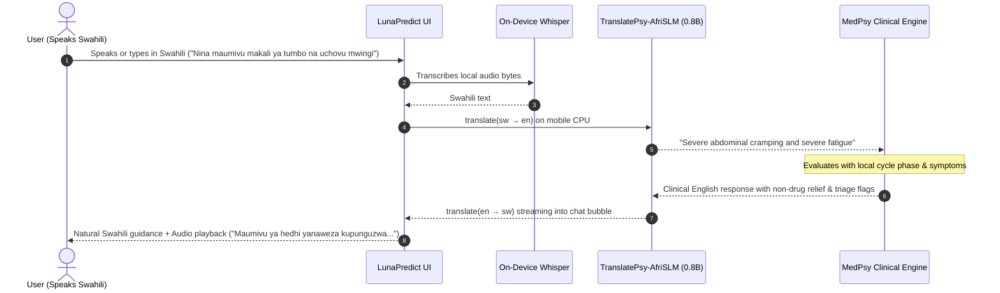
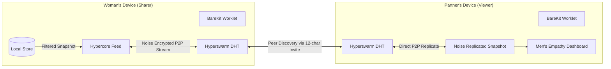

# 08. African Local Languages & P2P Partner Deep Dive

> *"Health intelligence should speak your mother tongue, and your private life should stay between you, your partner, and your phone."*

---

## Part 1: The African Local Language Problem

### 1.1 The Linguistic Exclusion in Modern Health AI

Over **1.4 billion people** live in Africa, speaking more than 2,000 distinct languages. **Swahili (Kiswahili)** alone is the lingua franca of over **200 million people** across Eastern and Central Africa (Kenya, Tanzania, Uganda, Rwanda, Burundi, DRC, and Mozambique).

Despite this scale, virtually every state-of-the-art medical LLM and commercial cycle tracking app (Flo, Clue, Apple Health, OpenAI, Llama) exhibits severe linguistic bias:
1. **English-Centric Medical Data**: Foundation medical models like Tether's **MedPsy** are explicitly benchmarked in English (`"Performance in other languages is not validated"` per MedPsy clinical documentation).
2. **The Clinical Barrier**: When a woman in East Africa experiences pelvic pain, morning sickness, postpartum blues, or perimenopausal hot flashes, asking her to articulate those sensations in clinical English is unnatural and creates an intimidating diagnostic barrier.
3. **Cloud Translation Violates Privacy & Connectivity**: Routing private medical text through Google Translate or DeepL leaks reproductive queries to cloud ad trackers, costs scarce cellular data, and fails entirely during power and internet outages in rural health outposts.

---

### 1.2 The QVAC Solution: TranslatePsy-AfriSLM (Starting with Swahili)

To break this barrier without sacrificing offline medical accuracy, LunaPredict implements an edge-native translation pipeline powered by Tether/QVAC’s **TranslatePsy-AfriSLM** collection:

| Model Component | Specifications | Role in LunaPredict |
|---|---|---|
| **TranslatePsy-AfriSLM-0.8B** | `TRANSLATEPSY_AFRISLM_0_8B_TRANSLATION_Q4_K_M` (641 MB) | Edge text translation fine-tuned for African languages. Outperforms massive cloud systems (TranslateGemma-27B and Qwen3.5-122B) on Flores-200 benchmarks. |
| **Whisper Tiny ASR (`sw`)** | Whisper GGML (75 MB) | Listens to spoken Swahili speech and outputs editable Swahili transcripts directly from device RAM. |
| **MedPsy 1.7B / 4B** | `HEALTHCARE_1_7B_MEDICAL_Q4_K_M` (1.28 GB) | High-precision English clinical reasoning engine. |
| **Chatterbox / Local TTS** | `expo-speech` / QVAC TTS | Reads verified responses aloud in natural Swahili speech. |

#### The Local Swahili Voice & Text Pipeline:


100% of this multi-model pipeline executes **on the phone in airplane mode**.

---

## Part 2: Peer-to-Peer Partner Sharing over Holepunch/Pears

### 2.1 The Inspiration: Dismantling the "Useless Father" Myth

During the 2026 World Cup, Belgium winger **Jérémy Doku** left team camp to fly to London for the birth of his son before returning to Seattle to play. A prominent sports television commentator controversially called fathers *"useless at childbirth,"* sparking international backlash.

While professional athletes can occasionally charter flights, **millions of partners cannot**:
- Soldiers on military deployment
- Offshore maritime and rig workers
- Long-haul logistics crews
- Long-distance and migrant workers

These partners are not "useless" — they are **uninformed**. Existing apps either ignore partners or demand full cloud account passwords, exposing the woman's entire personal history.

---

### 2.2 The Pears P2P Architecture (Zero Cloud Servers)

LunaPredict eliminates central servers completely by utilizing the **Holepunch / Pears stack** (`hyperswarm`, `corestore`, and `b4a`) via `react-native-bare-kit`:



1. **Blind Pairing (Invite Code)**:
   - The woman taps "Invite Partner." Luna generates a 12-character z-base-32 code (`xxxx-xxxx-xxxx`).
   - The code hashes deterministically via SHA-256 into an ephemeral DHT topic string (`lunapredict:pairing:<raw>`).
2. **Serverless Noise Encryption**:
   - The devices discover each other through the Hyperswarm DHT and negotiate a point-to-point **Noise protocol** encrypted channel.
   - No data touches any Luna server because **no Luna server exists**.
3. **Granular Woman-Controlled Privacy**:
   - She chooses what syncs via independent toggles:
     - `sharePhase`: Current menstrual cycle phase (e.g. Luteal, Follicular).
     - `sharePredictions`: Estimated period dates & fertility window.
     - `shareMood`: Mood and energy ratings from the past 48 hours.
     - `shareSymptoms`: Physical symptom tags.
     - `sharePregnancy`: Current gestational week.
   - She can disconnect or revoke access instantly with one tap (`unlink`).
4. **Actionable Men’s Empathy Dashboard**:
   - Instead of raw medical charts, the partner receives **context-aware coaching** on how to actually be helpful (e.g., *"She is in her late luteal phase: energy is naturally low and progesterone is dropping. Best ways to support today: take over dinner prep, avoid high-intensity plans, and give reassuring support."*).

---

## Part 3: What We Have Been Shipping (Commit Audit)

Our Git commit log documents intense, production-grade feature development and architectural hardening during the hackathon:

```text
* 8f039af - fix(coach): prevent AI from mentioning word count limits or prompt constraints
* 5d88f34 - feat(p2p): integrate Holepunch/Pears peer-to-peer partner sharing transport
* 8ce1bd1 - feat(coach): multi-session chat, markdown formatting, voice pause/cancel, TTS controls
* 5161ebb - feat(calendar): improve calendar markings, 6-cycle predictions, and interactive quick-flow across 4 modes
* 09dcf55 - perf(models): never block app launch on the QVAC cache check
* 2caf38d - build(qvac): pin QVAC native platform packages added by the Expo plugin
* ffe73e5 - docs: architecture, flows, algorithms and phone test guide for LunaPredict
* 718c5ef - test: whole-app smoke tests plus coach safety and prompt tests
* a23fe14 - feat(app): rebuild every screen around the new engine with proper UX flows
* b3c925d - feat(qvac): run Luna on-device with the QVAC SDK (MedPsy, TranslatePsy, Whisper)
* 3bdce94 - feat(ui): accessible design system with contrast-safe tokens
* e6b19a8 - feat(tracking): rebuild cycle engine with late periods, ovulation evidence and peri staging
* 2c2c4b0 - feat(build): add EAS config for Android APK builds
```

### Key Technical Breakthroughs Shipped:
1. **BareKit TypedArray IPC Optimization**:
   Identified and resolved the native JSI string-to-binary bridge mismatch in `react-native-bare-kit`, transitioning stream writes to typed `Uint8Array` buffers and eliminating native startup crashes.
2. **Clinical 6-Month Predictive Horizon**:
   Replaced simplistic 28-day assumptions with Bayesian cycle variance modeling ($\pm \sigma$), Wilcox et al. 1995 conception curves, and STRAW+10 perimenopause indicators.
3. **Multi-Session Chat & On-Device Memory**:
   Engineered clean session switching, token-budgeted conversational memory, markdown syntax rendering, and voice cancellation.
4. **Resilient Hardware Acceleration**:
   Added non-blocking OpenCL runtime fallbacks (`android:required="false"`) ensuring smooth CPU/GPU execution across disparate smartphone chipsets.
5. **Redesigned Identity & Adaptive Icons**:
   Designed and synchronized vector celestial crescent moon icons (`#BE123C`) across all standard Android mipmap buckets (`mdpi` through `xxxhdpi`).

